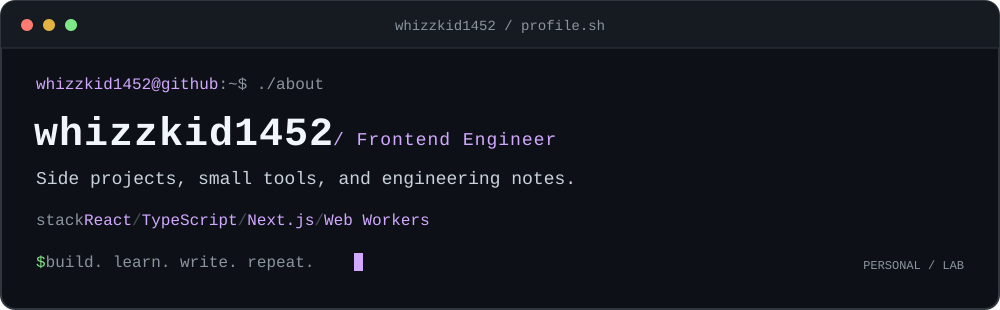

  

# 김승진 · whizzkid1452

직접 쓰는 도구를 만들고, 개발 과정에서 확인한 내용을 글로 남깁니다.  
프론트엔드와 오디오, 반복 작업을 줄이는 작은 라이브러리에 관심이 있습니다.

[블로그](https://devlog.dropai.site/) · [실무 GitHub](https://github.com/HURRAEY) · [이력서](https://app.notion.com/p/Software-Engineer-38073b56612a80efb6e1f5f7055e5c15) · [VOIX KIT](https://kit.an-ai.ai/)

### `$ ls projects/`

| 프로젝트 | 만드는 것 |
| --- | --- |
| [next-seo-contract](https://github.com/whizzkid1452/next-seo-contract) | Next.js App Router의 브라우저·크롤러별 SEO 응답을 검증하는 도구 |
| [remark-next-route-guard](https://github.com/whizzkid1452/remark-next-route-guard) | Markdown 링크를 실제 Next.js 경로와 대조하는 remark 플러그인 |
| [worker-task-pool](https://github.com/whizzkid1452/worker-task-pool) | 여러 CPU 작업을 제한된 수의 Worker에 배분하는 TypeScript 라이브러리 |
| [drop-ai](https://github.com/whizzkid1452/drop-ai) | 브라우저에서 AI와 함께 오디오를 편집하는 개인 프로젝트 |
| [blog](https://github.com/whizzkid1452/blog) | Next.js로 만든 기술 블로그와 글 원본 |

오디오 편집 코어는 [HURRAEY/daw-engine](https://github.com/HURRAEY/daw-engine)에서 개발합니다.

### `$ cat contributions.md`

- **[React Native #57558](https://github.com/react/react-native/pull/57558)** - Android `outlineColor`의 숫자 변환 오류를 수정하고 회귀 테스트를 추가했습니다. Meta 동기화를 통해 반영됐습니다.
- **[TanStack Query #11013](https://github.com/TanStack/query/pull/11013)** - 쿼리 키의 `undefined` 속성과 타임아웃 유효성 검증의 경계 조건 테스트를 추가했습니다. **Merged**
- **[Tone.js #1453](https://github.com/Tonejs/Tone.js/pull/1453)** - 오디오 테스트의 실행 범위와 검증 조건을 보완했습니다. **Merged · HURRAEY 계정 기여**

### `$ cat experience.md`

React·TypeScript·Electron 기반 미디어 에디터를 만듭니다.  
오디오 클립 1,500개 타임라인에서 Long Task를 73.9% 줄이고, 사내 TTS 편집기를 웹·Electron으로 출시했습니다.

### `$ cat stack.txt`

`TypeScript` `React` `Next.js` `Electron` `Web Audio API` `Web Workers`

---

[whizzkid1452](https://github.com/whizzkid1452) · 개인 프로젝트·기술 글 / [HURRAEY](https://github.com/HURRAEY) · 실무·에디터 개발
